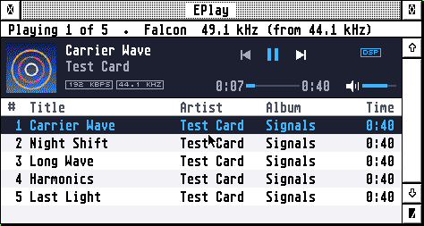
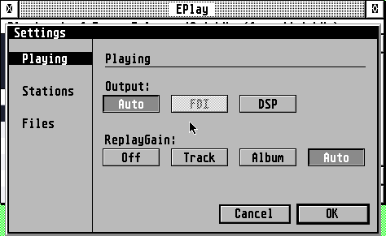

# EPlay


An audio player for the Atari Falcon, TT and STE: MP3 decoded on the Falcon's DSP, WAV and AIFF,
and web radio, in a GEM window. Written in C and DSP56001 assembly.



## Highlights

- **MP3 on the Falcon's DSP:** MPEG-1, 2 and 2.5 layer III, every bit rate.
- **WAV and AIFF:** 8 to 32 bits, mono or stereo, at their own pitch at any rate.
- **Through a SoundPool FDI:** set to the file's rate (44.1 or 48 kHz) and played bit for bit.
- **Steady sound:** fed by an interrupt from memory, so menus, dialogs and other programs don't break it up.
- **Gapless:** an album encoded with LAME plays from one track into the next with no gap.
- **ReplayGain:** evens out the loudness of tracks or albums from their tags.
- **Web radio:** Icecast and Shoutcast stations, http or https, with titles and pictures; Find station searches by genre, country and language.
- **Playlists:** files, folders and `.M3U`; reorder by dragging; Shuffle and Repeat.
- **Mini player:** the bar alone, in a small window.
- **Falcon, TT and STE:** WAV and AIFF on the TT's and STE's DMA sound too.



## Getting started

Download the latest `eplay-x.y.zip` from **[Releases](../../releases/latest)** and unpack it:

| File | What it is |
|---|---|
| `eplay.prg` | the program, for the Falcon and the TT |
| `eplayst.prg` | the program for an STE |
| `eplay.hyp`, `eplay.ref` | the guide, for EHypView or ST-Guide: **Help** opens it |
| `tls.ovl`, `cacert.pem` | secure (https) stations: keep them beside the program |

Start `eplay.prg`, or drop music files, a folder or a playlist on it. **File > Open...** adds more,
**File > Open URL...** plays a station, **Help > Keys...** lists the keys. The guide
([docs/GUIDE.md](docs/GUIDE.md)) has the rest.

**Needs:** a Falcon030 with TOS 4.0x or EmuTOS (MP3 needs its DSP), a TT, or an STE or Mega STE
with `eplayst.prg` (WAV and AIFF); a screen 640 pixels wide. Web radio needs a network card and
STinG or MiNTnet.

## AERA-Gateway

EPlay plays MP3 stations by itself. **Through the Gateway** (the Options menu),
[AERA-Gateway](https://github.com/whomper/AERA-Gateway) on a Raspberry Pi also plays stations that
send AAC, Ogg or HLS, sent on as MP3, and finds the stations' logos. It is optional.

## Building

```sh
sudo apt install gcc-m68k-linux-gnu a56 python3 sox lame
make && make st && make test
```

More in [docs/DEVELOPING.md](docs/DEVELOPING.md).

## Source

`src/` the formats and the decoder's C model, `dsp/` the MP3 decoder for the DSP56001, `atari/` the
sound hardware, `ui/` GEM, `radio/` the Gateway's radio service, `common/` the AERA library. The
full list is in [docs/DEVELOPING.md](docs/DEVELOPING.md).

## Tests

`make test` and `make dsptest`, with the Hatari rigs in `tests/hatari/`: see [docs/DEVELOPING.md](docs/DEVELOPING.md).

## Licence

EPlay is free software: you can redistribute it and/or modify it under
the terms of the GNU General Public License as published by the Free
Software Foundation, either version 2 of the License, or (at your option)
any later version. It is distributed in the hope that it will be useful,
but WITHOUT ANY WARRANTY; without even the implied warranty of
MERCHANTABILITY or FITNESS FOR A PARTICULAR PURPOSE. See [COPYING](COPYING).

Copyright (C) 2026 AERA | Erez Yaary. What it includes under other licences is in `NOTICES.TXT`.

---

Part of **AERA** for Atari: [ECal](https://github.com/whomper/ECal) · [EContact](https://github.com/whomper/EContact) · [EMail](https://github.com/whomper/EMail) · [EFTP](https://github.com/whomper/EFTP) · [EHypView](https://github.com/whomper/EHypView) · [ClaudeST](https://github.com/whomper/ClaudeST) · [EWeb](https://github.com/whomper/EWeb) · [EUpdate](https://github.com/whomper/EUpdate) · [EPDF](https://github.com/whomper/EPDF) · 8-bit: [EDOS](https://github.com/whomper/EDOS) · [EFTP_XL](https://github.com/whomper/EFTP_XL) · Gateway: [AERA-Gateway](https://github.com/whomper/AERA-Gateway)
