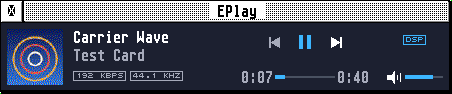

# EPlay


An audio player for the Atari Falcon, TT and STE: MP3 decoded on the Falcon's DSP, WAV and AIFF,
and web radio, in a GEM window. Written in C and DSP56001 assembly.


## Highlights

- **MP3 on the DSP:** the whole decoder (MPEG-1, 2 and 2.5 layer III, constant or variable bit
  rate) runs on the Falcon's DSP56001, checked bit for bit against a model that meets ISO
  11172-4's full accuracy. The 68030 only hands it the file's frames.
- **Steady sound:** the music is fed by an interrupt from a queue held in memory, so menus,
  dialogs and other programs don't break it up. An accelerated Falcon plays exactly as a stock one.
- **Through the FDI:** with a SoundPool FDI on the DSP port, EPlay sets it to the file's rate
  (44.1 or 48 kHz), as Cubase Audio does, and the music goes out bit for bit.
- **At its own pitch:** a file at a rate the Falcon's clock hasn't (44.1 kHz on a stock Falcon)
  is resampled on the DSP, MP3, WAV and AIFF alike.
- **Gapless:** an album encoded with LAME plays from one track into the next with no gap.
- **ReplayGain:** evens out the loudness of tracks or albums from their tags, louder only as far
  as each file's peak allows.
- **Web radio:** Icecast and Shoutcast stations, http or https, with the songs' titles and the
  station's picture; a Direct connection, or Through the AERA Gateway for AAC, Ogg and HLS.
- **Playlists:** add files, folders and `.M3U` playlists; reorder by dragging; Shuffle and Repeat;
  save the list as an `.M3U`.
- **The TT and the STE:** WAV and AIFF on their 8-bit DMA sound, CD's 44.1 kHz at 50 kHz;
  `eplayst.prg` is the STE's edition.



## Getting started

Download the latest `eplay-x.y.zip` from **[Releases](../../releases/latest)** and unpack it:

| File | What it is |
|---|---|
| `eplay.prg` | the program, for the Falcon and the TT |
| `eplayst.prg` | the program for an STE |
| `eplay.hyp`, `eplay.ref` | the guide, for EHypView or ST-Guide: **Help** opens it |
| `tls.ovl`, `cacert.pem` | secure (https) stations on a Direct connection: keep them beside the program |
| `icons/` | the desktop icon (`eplay.rsc`, or `eplay.icn` and `eplaymk.icn`) |
| `notices.txt` | what EPlay includes under other licences |

1. Start `eplay.prg`, or drop `.MP3`, `.WAV` or `.AIF` files, a folder or an `.M3U` playlist on it.
2. **File > Open...** (^O) adds files and folders to the list; a double click or Return plays a
   row. **Space** plays and pauses, **Left** and **Right** skip 10 seconds, **Shift+Left** and
   **Shift+Right** go to the previous and next file, **+** and **-** set the volume. **Help >
   Keys...** lists them all.
3. **File > Open URL...** (Shift+^O) plays a web radio station: type its address, or choose one of
   the last ten. **Options** chooses a **Direct connection** or **Through the Gateway**.
4. **View > Mini player** makes the window the bar alone.
5. **Options > Settings...** (^,) chooses the output (Auto, FDI or DSP), the Gateway's address and
   port, and ReplayGain.


`EPLAY.INF`, beside the program, keeps the settings, the volume and the last folders and
stations. `EPLAY.LOG` says what EPlay found and did; please send it with any report.

**Needs:** a Falcon030 with TOS 4.0x or EmuTOS (MP3 needs its DSP), a TT, or an STE or Mega STE
with `eplayst.prg` (WAV and AIFF), and a screen 640 pixels wide or more. Web radio needs a network
card and STinG or MiNTnet.

## How it reaches the servers

Only for web radio, through STinG or MiNTnet:

- **Direct connection** (the default): EPlay asks the station itself, over HTTP with
  `Icy-MetaData: 1` for the songs' titles, or HTTPS through the family's `TLS.OVL`. Redirects and
  `.pls`/`.m3u` station lists are followed. MP3 stations only.
- **Through the Gateway:** EPlay asks the [AERA Gateway](https://github.com/whomper/AERA-Gateway)
  (`GET /stream?url=...`), which fetches the station and sends it on as MP3; AAC, Ogg and HLS
  stations need it. Install its radio service on the Pi (`sudo aera-gateway install radio`) and
  give its address and port (8580) in Settings. With a Gateway given, EPlay also asks it for a
  station's logo.

A picture a station names with its titles is fetched from where it is. EPlay sends nothing else
anywhere.

## Building

```sh
sudo apt install gcc-m68k-linux-gnu a56 python3 sox lame   # Debian/Ubuntu; no MiNTLib needed
make            # binary/eplay.prg, with the DSP's program built in
make st         # binary/eplayst.prg, the STE's
make test       # the host tests
make dsptest    # the DSP's program against the model, bit for bit, on Hatari's DSP core
make help HCP=/path/to/hcp   # binary/eplay.hyp from docs/GUIDE.md
make dist       # dist/eplay-x.y.zip, as on the Releases page
```

`binary/` and `dist/` are never committed. Releases are made by the Release workflow on `main`
(`tools/bump.py`, then **Actions > Release > Run workflow**).

## Source

```
src/        WAV and AIFF, tags and ReplayGain, playlists, the play order, web radio's parsing;
            the MP3 frame parser and the decoder's C model (src/mp3)
dsp/        the MP3 decoder for the DSP56001 (mp3.a56)
atari/      the sound hardware: the ring and the matrix, the tick, the DSP, the log
ui/         GEM: the window, the menus, the player, Settings, web radio
radio/      radiogate, the Gateway's radio service (handed to AERA-Gateway)
common/     the AERA library (from AERA-Atari, by git subtree)
data/       the standard's tables (Huffman codes, the synthesis window)
tools/      the table generators, the version bump
tests/      the host tests, the DSP's, and the Hatari rigs (tests/hatari)
docs/       the guide (GUIDE.md, the source of eplay.hyp), the design (DESIGN.md), the pictures
```

## Tests

- `make test`: the decoder's C model against minimp3 within ISO 11172-4's limits; WAV and AIFF
  against sox; tags and ReplayGain; web radio's parsing under AddressSanitizer, with its fuzz
  corpus replayed (`make fuzz` runs the fuzzer).
- `make dsptest`: `dsp/mp3.a56` on Hatari's DSP core against the model, bit for bit, gapless joins
  and ReplayGain included.
- `tests/hatari/play_test.py`: EPlay in Hatari on a stock Falcon and others, its sound recorded
  and checked (pitch, gaps, length, level): files, playlists, folders, Shuffle, Repeat, gapless,
  ReplayGain, the dialogs and the mini player.
- `tests/hatari/stream_test.py`: web radio in Hatari from a station of its own: titles,
  reconnecting, redirects, chunked answers, https, pictures, and the Gateway.
- `tests/hatari/speed.py`: the family's speed rig, each action's longest stretch between event
  calls; the figures are in `docs/DESIGN.md`.
- `tests/hatari/docs_shots.py`: the pictures above.

## Licence

EPlay is free software: you can redistribute it and/or modify it under
the terms of the GNU General Public License as published by the Free
Software Foundation, either version 2 of the License, or (at your option)
any later version. It is distributed in the hope that it will be useful,
but WITHOUT ANY WARRANTY; without even the implied warranty of
MERCHANTABILITY or FITNESS FOR A PARTICULAR PURPOSE. See [COPYING](COPYING).

Copyright (C) 2026 AERA | Erez Yaary.

It includes, under their own licences (compatible with the GPL; see `NOTICES.TXT`):

- the MP3 standard's Huffman codes and synthesis window as FFmpeg transcribes them
  (`data/`, GNU LGPL 2.1 or later);
- BearSSL and Mozilla's root certificates, in `TLS.OVL` and `CACERT.PEM` (common's);
- for the tests only, not in `EPLAY.PRG`: minimp3 by Lion (lieff), CC0 1.0.

---

Part of **AERA** for Atari: [ECal](https://github.com/whomper/ECal) · [EContact](https://github.com/whomper/EContact) · [EMail](https://github.com/whomper/EMail) · [EFTP](https://github.com/whomper/EFTP) · [EHypView](https://github.com/whomper/EHypView) · [ClaudeST](https://github.com/whomper/ClaudeST) · [EWeb](https://github.com/whomper/EWeb) · [EUpdate](https://github.com/whomper/EUpdate) · [EPDF](https://github.com/whomper/EPDF) · 8-bit: [EDOS](https://github.com/whomper/EDOS) · [EFTP_XL](https://github.com/whomper/EFTP_XL) · Gateway: [AERA-Gateway](https://github.com/whomper/AERA-Gateway)
